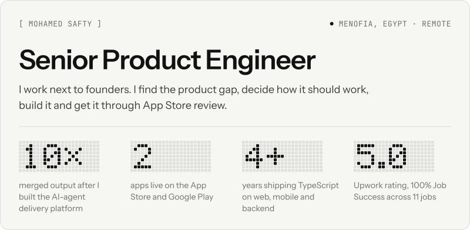

<picture>
  <source media="(max-width: 600px) and (prefers-color-scheme: dark)" srcset="assets/card-dark-mobile.svg">
  <source media="(max-width: 600px)" srcset="assets/card-light-mobile.svg">
  <source media="(prefers-color-scheme: dark)" srcset="assets/card-dark.svg">
  
</picture>

| Work | Role | Years |
| --- | --- | --- |
| [Universe Dawn](https://mohamed-safty-portfolio.vercel.app/work/universe-dawn) | Lead engineer. Mobile app rebuilt to desktop parity | 2022 to now |
| [PitchHub](https://mohamed-safty-portfolio.vercel.app/work/pitchhub) | Solo developer. Live on both app stores | 2025 to now |
| [Meezan](https://mohamed-safty-portfolio.vercel.app/work/meezan) | Lead frontend. 99 routes across 36 modules | 2025 to now |

[Portfolio](https://mohamed-safty-portfolio.vercel.app/) · [CV](https://mohamed-safty-portfolio.vercel.app/mohamed-safty-cv.pdf) · [LinkedIn](https://www.linkedin.com/in/mohamed-safty/) · [Upwork](https://www.upwork.com/freelancers/~011c88da58a37793f4) · [X](https://x.com/me_safty) · [Contact](https://mohamed-safty-portfolio.vercel.app/#contact)
